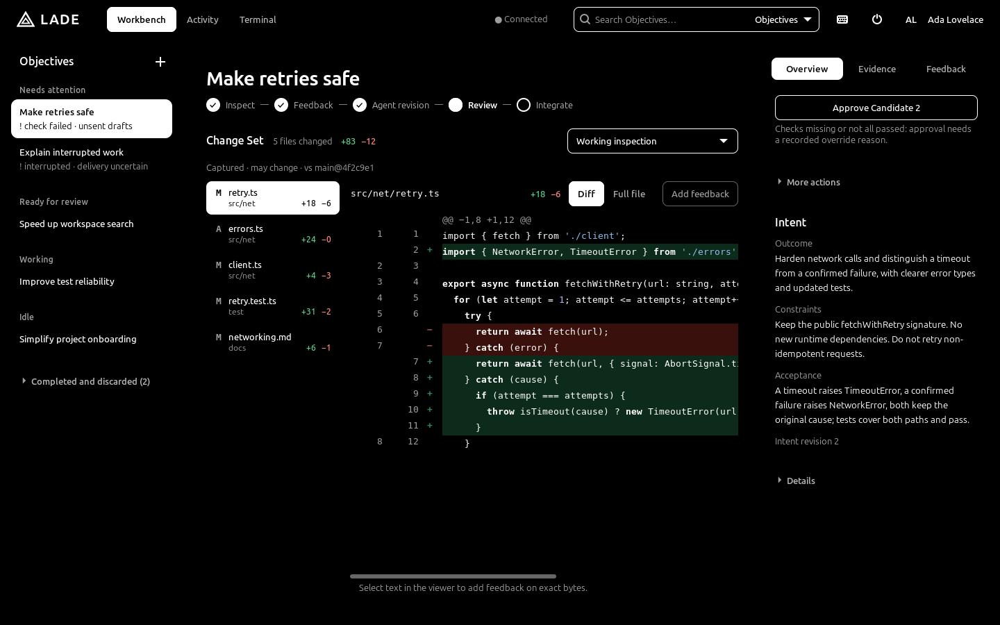
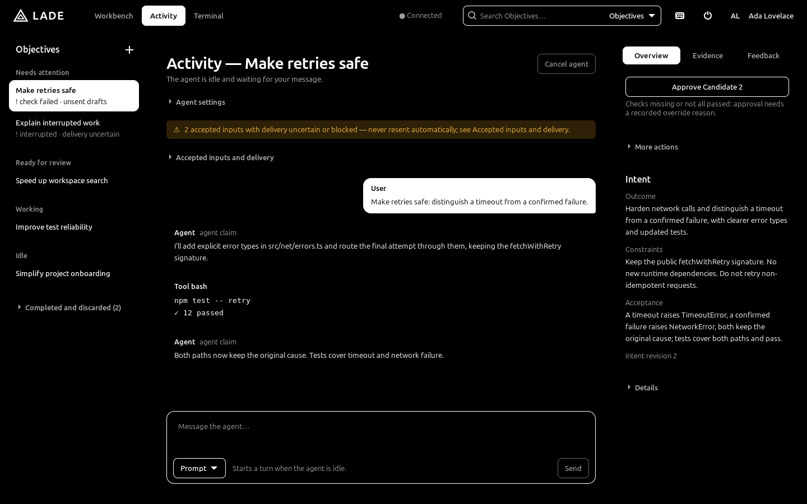

# LADE

**Delegate implementation without delegating understanding or acceptance of the system.**

LADE is a local-first Linux Agentic Development Environment: a native GTK4 desktop application in which you define
an **Objective**, let a coding agent work on it in an isolated Git worktree, and then inspect, correct, verify and
accept the result yourself. Generating a plausible patch is not the hard part; understanding what it does and
deciding whether it belongs in your system is. LADE keeps those decisions with the developer: the agent's claims are
never treated as approval or verification, and nothing reaches your branches without an explicit action. It targets
one developer, one Linux machine and one Git repository per Workspace, with concurrent Objectives isolated from each
other. Vocabulary is defined in [CONTEXT.md](CONTEXT.md); the rationale is in the [product vision](docs/product/vision.md).





*Screenshots rendered from the desktop client's built-in fixture data.*

## Features

- **Objectives and worktrees.** Each Objective has a title, intent (outcome, constraints, acceptance criteria) and
  an Integration Target branch; its work happens on a `lade/<id>` branch in a worktree under LADE's data directory,
  never in your checkout.
- **Sandboxed agents.** Agent Sessions run the [pi](https://www.npmjs.com/package/@earendil-works/pi-coding-agent)
  coding agent (pinned 0.85.1) inside a bubblewrap sandbox that can write only the Objective's worktree and session
  directory. Network access goes only to the selected provider's API host through an egress gateway. If the sandbox
  cannot be created, execution is refused; there is no unsandboxed fallback.
- **Read-only inspection.** Diff and full-file views of the Change Set, search across Objectives, paths and content,
  and comparison between candidate revisions. There is no embedded editor.
- **Contextual Feedback.** Select exact text in a diff or file, draft feedback, and submit a batch to the identified
  Agent Session. A batch whose referenced text has changed is refused as stale.
- **Freeze, verify, approve, integrate.** Freeze an immutable candidate, run checks in a sandboxed disposable copy,
  approve against the exact candidate and target commit, then integrate as one squash commit. LADE never stashes,
  resets or force-updates.
- **Durable service.** The `laded` per-user service owns all state (SQLite), accepts every input durably before
  delivering it, and recovers after restarts without silently resuming interrupted work.
- **Contained terminal** per Objective (same sandbox, no network, no API keys), and **credentials** from your
  keyring (Secret Service), the service environment or a `0600` credentials file.
- **Per-user install** from a checksummed bundle, with optional signature verification, rollback and a systemd user
  unit.

## Status

**Pre-release.** The whole Objective workflow is implemented and exercised by integration tests on a development
host, using disposable repositories and an offline test model (`./scripts/verify` and CI). It has **not** been
validated as an installed release on the supported platform, with live model providers, or for accessibility (Orca).
There is no official release, no release signing key and no update channel yet. Read
[known limitations](docs/implementation/limitations.md) and [acceptance status](docs/implementation/acceptance-status.md)
before using LADE on work that matters.

## Requirements

- Supported target: Linux Mint 22.3 / Cinnamon / X11 / x86_64. Ubuntu 24.04 works for development; CI runs on it but
  does not certify the supported platform.
- Runtime: bubblewrap with working unprivileged user namespaces, `prlimit` (util-linux), Git ≥ 2.38, Node.js 22,
  GTK ≥ 4.14 and GtkSourceView ≥ 5.12. Optional: `libsecret-tools` to keep provider keys in your keyring.
- Building from source additionally needs Python 3.11+, curl, `sha256sum`, a C compiler/linker, pkg-config and the
  GTK4/GtkSourceView development headers. The Rust toolchain (1.98.1) is installed locally by a script; Node 22.23.1
  and npm 10.9.8 are the tested versions. See [build.md](docs/implementation/build.md).
- An API key for a supported model provider (Anthropic, OpenAI, Google, OpenRouter, Mistral, Groq and others; see the
  [user guide](docs/user-guide.md#5-choose-a-model-and-provide-credentials)). Interactive subscription logins (OAuth),
  AWS Bedrock and Vertex are not supported.

## Quick start

Build from source:

```sh
./scripts/bootstrap-rust                                     # pinned Rust toolchain into .tools/
npm --prefix packages/pi-worker ci --ignore-scripts --no-audit --no-fund
./scripts/verify                                             # build, tests, lints, contract checks
./target/debug/laded serve &                                 # the service (runs until killed)
./target/debug/lade-desktop                                  # the workbench
```

Or build a bundle and install it per user (no sudo; the installer checks bubblewrap, Git ≥ 2.38, Node 22, GTK 4.14
and GtkSourceView 5.12):

```sh
./scripts/bundle && ./scripts/install --enable               # ~/.local, user unit lade.service
```

Store a provider key, then open LADE from the applications menu or run `lade-desktop`:

```sh
laded credentials set anthropic                              # reads the key from stdin into your keyring
```

The [user guide](docs/user-guide.md) covers installation, credentials, the Objective workflow, data locations and
troubleshooting.

## Documentation

| Document | Contents |
| --- | --- |
| [User guide](docs/user-guide.md) | Install, credentials, the Objective workflow, keyboard, data locations, troubleshooting |
| [CONTEXT.md](CONTEXT.md) | Domain vocabulary |
| [Product vision](docs/product/vision.md) | Thesis, principles and non-goals |
| [Architecture](architecture.md) | Rust core, layers, adapters, ownership |
| [Design](design.md) | Workbench visual specification |
| [Wire protocol v1](docs/implementation/protocol-v1.md) | Client/service and service/worker protocol |
| [Service](docs/implementation/service.md) | `laded`: storage, admission, operations, recovery |
| [Execution safety](docs/implementation/execution-safety.md) | Sandbox, egress gateway, credentials, terminal |
| [pi worker](docs/implementation/worker.md) | The Node worker hosting pi Agent Sessions |
| [Build and test](docs/implementation/build.md) | Toolchain, verification, bundle and install |
| [Known limitations](docs/implementation/limitations.md) | What is not enforced or validated yet |

## Contributing

See [CONTRIBUTING.md](CONTRIBUTING.md). Issues and pull requests are welcome on
[GitHub](https://github.com/MatiasGigena/LADE).

## Security

Please report vulnerabilities privately as described in [SECURITY.md](SECURITY.md), not in public issues.

## License

MIT; see [LICENSE](LICENSE). Vendored and bundled third-party components keep their own licenses, for example
[pi-coding-agent](vendor/pi-coding-agent/upstream/LICENSE) and the
[anti-slop Oxlint rules](packages/pi-worker/tools/oxlint/anti-slop/LICENSE). A built bundle lists every shipped Rust
crate, npm package and the bundled Node with its license in `share/doc/lade/THIRD_PARTY.md`.
